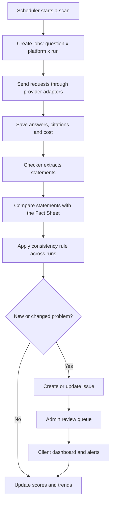

# TrueCite

Know what AI tells your customers about you, and fix what it gets wrong.

| Item | Detail |
|---|---|
| Document | Product idea and plan for the TrueCite web application |
| Version | 1.0 |
| Date | October 2026 |
| Status | Planning and validation |
| Owner | [Your name] |

> Note: All cost and price figures in this document are rough estimates based on typical AI API prices at the time of writing. Prices change often, so confirm them with a small test run and each provider's current pricing page before setting final prices.

## Name and positioning

| Item | Detail |
|---|---|
| Name | TrueCite |
| Meaning | Sounds like "true sight": seeing clearly what AI says about a company. "Cite" points to the key feature, tracing the sources behind AI answers. |
| Alternatives | BrandEcho, FactLens, Verilo, AnswerGuard |
| Domain ideas | truecite.ai, truecite.io, gettruecite.com, truecite.in (check availability) |
| Tagline | Know what AI tells your customers about you, and fix what it gets wrong. |
| One-line pitch | Media monitoring for the AI era: TrueCite shows PR, brand and legal teams what AI assistants say about their company, what is wrong, where it came from and how to fix it. |
| Category | AI reputation monitoring (B2B SaaS) |

Before committing to the name, check that the domain and social handles are free, and search the trademark registers in the markets you plan to sell in (for India, the IP India public trademark search).

## Summary

TrueCite is a web application that monitors what AI assistants such as ChatGPT, Gemini, Perplexity and Claude say about a company. It asks these assistants the questions real customers ask, compares the answers with the company's official public information, and flags anything that is wrong, outdated or misleading. For every error, TrueCite shows where the wrong information most likely comes from, gives clear steps to fix it, and keeps re-checking until the AI gets it right.

TrueCite needs no access to a client's systems, analytics, website backend or customer data. Everything it uses is public: AI answers, the client's public website and public web pages. This makes it safe and simple for companies to buy, with very little for their security team to review.

The business earns money from a paid one-time audit, which acts as the entry product, and a monthly subscription for ongoing monitoring. It targets mid-size and large companies, starting with clients in India and expanding to international clients who pay higher prices.

## The problem

More and more people ask AI assistants about companies before they buy, apply for a job or sign a contract. They ask questions like "How much does this product cost?", "Is this company trustworthy?" or "Which is better, this brand or that one?" Unlike a search results page with many links, an AI assistant gives one confident answer, so people tend to believe it.

These answers are often wrong. AI assistants quote old prices, describe products that were discontinued, name former leaders, mix a company up with another business that has a similar name, or repeat rumors and old news as if they were current facts. Most companies have no idea this is happening, because nobody inside the company is checking.

Wrong AI answers cost companies customers, create extra support work and damage trust. In regulated industries such as banking, insurance and healthcare, a false claim about fees, safety or compliance can also become a legal or regulatory problem. Traditional media monitoring tools track news and social media, not AI answers. AI visibility tools mostly measure whether a brand is mentioned, which helps marketing teams, but they focus less on whether what AI says is actually true and how to correct it.

## The solution

TrueCite does four jobs, in this order.

| Job | What TrueCite does | Value for the client |
|---|---|---|
| Find | Asks AI assistants hundreds of real customer questions on a schedule and checks every answer against the company's approved facts | The company finally knows what AI tells its customers |
| Explain | Traces each wrong answer to its most likely sources, such as an outdated article, an old page on the company's own site or a forum thread | The team understands why the error exists |
| Fix | Gives step-by-step fix guidance for each type of error from a built-in Fix Playbook | The team knows exactly what to do next |
| Track | Re-checks fixed issues and shows progress per AI platform over time | The team can prove progress to leadership |

TrueCite is a product, not an agency service. The client's own team carries out the fixes using TrueCite's guidance. A done-for-you option can be offered later through a partner PR agency.

## Who it's for

TrueCite is built for mid-size and large companies, roughly 200 employees and above, that have a PR, brand, marketing or legal team. In the beginning, mid-size companies of about 200 to 2,000 employees are the best target, because they decide faster than very large enterprises while still having real budgets.

The best-fit industries are those where wrong information is especially costly: banking, fintech and NBFCs, insurance, hospital chains and healthcare, edtech, real estate developers, airlines and travel, software and SaaS companies, and large consumer and D2C brands. The plan is to win early clients in India, then sell to international clients in markets such as the US, UK, UAE and Australia, where the same product can be sold at higher prices.

| Buyer | What they care about | How TrueCite helps |
|---|---|---|
| Head of PR or Corporate Communications | Reputation, misinformation, crisis prevention | Alerts for new errors, fix plans, monthly leadership reports |
| Brand or Marketing Head | Correct product and pricing information, standing against competitors | Accuracy by product and category, competitor comparison |
| Legal and Compliance | False claims, regulatory exposure, evidence | Instant alerts for critical issues, a dated evidence trail of every AI answer |
| HR and Employer Brand (later) | What AI tells job seekers | Careers question set and employer reputation view |

TrueCite is not designed for very small local businesses. Its pricing, features and sales approach assume a client with a team that owns the company's reputation.

## Why now

AI assistants have become a normal way to research companies, and their answers arrive as a single confident response rather than a list of links, which makes a wrong answer more damaging. At the same time, companies already understand and budget for media monitoring, so TrueCite fits into a category buyers know. Finally, AI answers change constantly as models update and new pages are published, which means one check is never enough. That makes ongoing monitoring, and a monthly subscription, the natural business model.

## How it works

The table below shows the journey of a new client from sign-up to a resolved issue.

| Step | What happens |
|---|---|
| 1 | The client signs up and adds the company name, website, up to five competitors, markets and languages. |
| 2 | TrueCite reads the public pages of the client's website and drafts a Fact Sheet of key facts. The client reviews, corrects and approves it. |
| 3 | TrueCite generates a Question Set of realistic customer questions. The client can edit, add or turn off questions. |
| 4 | The first scan runs across the enabled AI platforms. Each question is asked several times on each platform. |
| 5 | The checker compares every answer with the approved facts and groups problems into issues, each with a severity level. |
| 6 | The dashboard shows the Accuracy Score, open risks, results per AI platform and a comparison with competitors. |
| 7 | Each issue shows the wrong statement, the correct fact, the likely sources and recommended fix steps. |
| 8 | The client's team applies the fixes and marks the issue as fixed. TrueCite re-checks it on every scan. |
| 9 | When the AI answers correctly and consistently, the issue moves to Resolved. If the error returns, it is reopened. |
| 10 | A monthly report goes to the client's leadership with the score, trends, top risks and fixes completed. |

## Core features (MVP)

### Company setup and Fact Sheet

The client enters the company name, website, competitors, markets and languages. TrueCite then reads the public pages of the client's website, such as the home, about, pricing, products, leadership, policy and press pages, and uses AI to draft a Fact Sheet. This is the "source of truth" that every AI answer is checked against.

Each fact has a category (for example pricing or leadership), the statement itself, an importance level (critical, high, medium or low), the public page it came from, and "valid from" and "valid to" dates. The dates matter because they let TrueCite recognize outdated answers: if AI quotes a price that was correct in 2024 but changed in 2025, the error is labelled as outdated rather than simply wrong, which also hints at where it came from.

The client reviews and approves the facts, and only approved facts are used for checking. Clients can add facts manually, but these are still public facts about the company, so TrueCite never needs private data.

### Question Sets

TrueCite generates questions that sound like real customers, grouped by category. The client can edit them, add their own and switch off any that don't apply. Each question has a priority: key questions are checked on every scan, while standard questions can be checked less often to control costs. English comes first; Hindi and Hinglish questions are planned as a differentiator for the Indian market.

| Category | Example questions |
|---|---|
| Pricing and plans | "How much does [Brand] cost?" "Does [Brand] have a free plan?" |
| Products and features | "Does [Brand] offer [feature]?" "Is [Product] still available?" |
| Company facts | "Who is the CEO of [Brand]?" "Where is [Brand] headquartered?" |
| Trust and safety | "Is [Brand] legit?" "Is [Brand] safe to use?" |
| Comparisons | "[Brand] vs [Competitor], which is better?" "Best alternatives to [Brand]" |
| Policies and support | "What is [Brand]'s refund policy?" "Does [Brand] offer 24/7 support?" |
| Reputation and controversies | "Has [Brand] had a data breach?" "Are there lawsuits against [Brand]?" |
| Careers | "Is [Brand] a good place to work?" "How are salaries at [Brand]?" |

### Multi-AI scanning engine

The scanning engine sends each question to each enabled AI platform through the providers' official APIs. Where a provider offers web search or search grounding, TrueCite turns it on, because many real users get answers based on live web search, and answers without it may not match what customers actually see. Each question is asked two or three times per platform in every scan, because AI answers vary from one run to the next.

For every answer, TrueCite stores the full text, any links the AI cited, the model and settings used, the time of the request and its cost. Each provider is built as a separate adapter behind a common interface, so adding a provider or switching to a newer model is a configuration change rather than a rewrite.

API answers are a close approximation of what people see in the consumer apps, not an exact copy, because the apps add their own settings and personalization. TrueCite's reports state this clearly, along with the date, platform and settings of every scan.

| Platform | How it is accessed | Notes |
|---|---|---|
| ChatGPT (OpenAI) | OpenAI API with web search enabled | Start here, since you already have an API key |
| Gemini (Google) | Gemini API with Google Search grounding | Check current pricing for grounded requests |
| Perplexity | Perplexity API | Returns citations, which is very useful for source tracing |
| Claude (Anthropic) | Anthropic API | Check docs.claude.com for current models, pricing and web search support |
| Google AI Overviews | May not have an official API | Leave out of the MVP; never scrape against a provider's terms |

### Accuracy checker

After the answers are collected, a cheaper AI model acts as the checker in five steps. First, it extracts each factual statement the answer makes about the company, such as "The Basic plan costs $49 per month." Second, it matches each statement to the related fact in the Fact Sheet. Third, it gives the statement a verdict. Fourth, it applies a consistency rule: a statement becomes an issue only if it appears in at least two of three runs on a platform, or on more than one platform, while one-off statements are logged as intermittent and watched. Fifth, it sets a severity based on the importance of the fact and the type of error, so a false claim about a lawsuit is critical while a wrong founding year is low.

| Verdict | Meaning | Example |
|---|---|---|
| Correct | Matches an approved, current fact | "The Basic plan costs $79 per month." |
| Incorrect | Contradicts a current fact | "The Basic plan costs $49 per month." when it costs $79 |
| Outdated | Matches a fact that is no longer valid | Names the former CEO |
| Confused | Describes another company | Mentions a data breach that happened at a similarly named firm |
| Unsupported | Not covered by the Fact Sheet and cannot be verified | "Offers 24/7 phone support" when support hours are not listed |
| Missing | AI does not give an important fact it should know | Says it has no information about the company's pricing |

Every verdict comes with a confidence score. In the early stage, all issues go through an admin review queue before the client sees them, so false alarms never reach clients and damage trust. Once the checker has proven reliable, only low-confidence verdicts need review. Clients can also mark an issue as "Not an error", which feeds back into the checker's rules.

### Source tracing

For each issue, TrueCite collects the links the AI cited, which Perplexity and web search modes usually provide. It then fetches those public pages and checks whether they contain the wrong statement, marking the most likely sources. Common sources include old pages or PDFs on the company's own website, news articles, review sites, forums such as Reddit and Quora, business directories, Wikipedia and Wikidata, and competitor pages.

When an answer has no citations, it probably comes from what the model learned during training. TrueCite labels these issues as "from AI memory" and suggests longer-term fixes, such as strengthening official pages and trusted third-party sources, while explaining that this kind of error usually takes longer to change.

### Issues and fix workflow

Each confirmed problem becomes an issue. The issue page shows the question that was asked, the AI platforms involved, the exact wrong statement with the error marked, the correct fact, the likely sources, the severity, when it was first and last seen, and the recommended fix steps from the Fix Playbook. Team members can assign issues to each other and add notes.

| Status | Meaning |
|---|---|
| Open | A confirmed error nobody has acted on yet |
| In progress | Someone on the client's team is working on the fix |
| Fixed, re-checking | The fix is done and TrueCite is checking whether AI answers have changed |
| Resolved | AI answers have been correct and consistent for two scans in a row |
| Reopened | The error came back after being resolved |

Every change of status is saved with the date, time and the person who made it. Legal and compliance teams value this evidence trail, because it shows exactly what AI said and when.

### Fix Playbook

The Fix Playbook is a built-in library of standard fixes for each type of error. TrueCite shows the relevant steps inside every issue, and the playbook grows as you learn from real clients.

| Error type | Common cause | Recommended fix |
|---|---|---|
| Wrong price | Old review articles, old pricing pages still live, outdated listings | Update the pricing page with clear text, redirect old pricing pages, ask publishers to update articles, add a pricing FAQ |
| Product described as discontinued, or a product that doesn't exist | Old press releases, retired pages without redirects | Publish a clear "current products" page, redirect retired pages, update directory and marketplace listings |
| Confused with another company | Similar names, inconsistent company details across the web | Add a clear description on the About page, keep the company name and details consistent on LinkedIn, Crunchbase and directories, add Organization structured data that links official profiles |
| False scandal or legal claim | Misattributed news, rumors on forums | Publish a factual clarification, ask the publisher for a correction, involve the PR team, and have the client's lawyers review anything that may be defamatory |
| Outdated leadership or company facts | Old bios and press kits | Update the leadership page, press kit and LinkedIn; for Wikipedia, request changes on the article's talk page instead of editing it directly, as Wikipedia's conflict-of-interest guideline expects |
| Wrong policy (refunds, warranty, fees) | Old policy pages or third-party summaries | Update and date policy pages, add an FAQ, remove or redirect old versions |
| AI cannot read the company's pages | AI crawlers blocked in robots.txt, pages that need JavaScript to show content | Allow the AI crawlers the company wants in robots.txt, make key pages readable without JavaScript |
| Negative answers based on old reviews | Few recent reviews on major platforms | Respond to reviews publicly, encourage recent customers to leave honest reviews |

TrueCite never promises that an AI assistant will change its answer by a certain date. Assistants that use live web search often update within days or weeks, while answers based on training data can take months.

### Dashboard and scores

The main dashboard shows the Accuracy Score and its trend, open issues by severity, results per AI platform, results per question category, what changed since the last scan, and how the company compares with its competitors.

The Accuracy Score runs from 0 to 100. Every checked statement gets a weight based on the importance of the related fact: 10 for critical, 5 for high, 2 for medium and 1 for low. Unsupported statements are left out until someone reviews them.

```
Accuracy Score = 100 × (total weight of correct statements) ÷ (total weight of all checked statements)
```

Next to the score, the dashboard shows Open Risks, the number of open critical and high issues, which is the number leadership will watch most closely. Two secondary measures give extra context: sentiment, meaning whether AI answers about the brand sound positive, neutral or negative, and share of voice, meaning how often the brand is mentioned in category questions compared with competitors. These stay secondary on purpose, because TrueCite's focus is accuracy, not visibility.

### Competitor comparison

TrueCite runs a lighter scan for two to five competitors, using fewer questions, and compares their Accuracy Score, sentiment and share of voice with the client's. Competitor Fact Sheets are drafted from their public websites without anyone confirming them, so competitor scores are shown as estimates. This view is powerful in sales and inside the client's company, because "AI is more accurate about our competitor than about us" gets leadership's attention quickly.

### Alerts

New critical and high issues trigger an email alert straight away, while everything else goes into a weekly digest. The client controls who receives which alerts. Slack, Microsoft Teams and WhatsApp alerts are planned for later, with WhatsApp being especially useful for Indian clients.

### Reports

The monthly report, available as a PDF and a web link, gives leadership the Accuracy Score and its trend, the top open risks, the issues fixed that month, what comes next, the competitor comparison and a short method note covering dates, platforms, number of questions and limitations. The one-time Full Audit report is a deeper version of the same report and serves as the paid entry product. Enterprise clients and agencies can later add their own logo to reports.

### Prospect report generator (internal sales tool)

This is your own tool for cold outreach. You enter a company name and website, TrueCite runs a small scan of about 20 to 30 questions on two platforms, and you review the findings. It then creates a short report with three to five real errors, available as a PDF and as a private web link that expires after 30 days. This report is the hook in your cold emails and LinkedIn messages. At typical prices, each prospect report should cost roughly $1 to $6 in API usage.

### Admin panel (internal)

The admin panel is only for you. It shows all clients and their plans, the status of every scan with failed jobs and retries, the issue review queue, the API cost of each client compared with what they pay, model and provider settings, prospect reports and feature switches. If you add a "view as client" option for support, every use of it should be logged.

## Pages and screens

| Page | Who sees it | Purpose |
|---|---|---|
| Landing page | Public | Explain the problem and the product, show a corrected AI answer, invite companies to request a free check |
| Pricing | Public | Plans in USD or INR depending on the visitor's location, with GST shown for India |
| Sample report | Public | An anonymized example report so buyers can see exactly what they get |
| Free check request | Public | A short form to request a mini-report; requests go to your admin queue instead of running automatically, which controls costs and prevents abuse |
| Sign up and log in | Public | Account creation with email login and optional Google login |
| Legal pages | Public | Terms of Service, Privacy Policy, Refund and Cancellation Policy, Contact; payment gateways in India usually require these before activating your account |
| Onboarding | Client | Step-by-step setup: company details, Fact Sheet review, Question Set review, first scan |
| Dashboard | Client | Accuracy Score, open risks, trends, results per platform and category |
| Issues | Client | List of all issues with filters for severity, status, platform and category |
| Issue detail | Client | The proof view: wrong statement, correct fact, sources, fix steps, history |
| Questions | Client | Manage the Question Set and priorities |
| Fact Sheet | Client | Review, approve and update facts, with dates |
| Sources | Client | All sources found across issues, grouped by website |
| Competitors | Client | Comparison of scores, sentiment and share of voice |
| Reports | Client | Monthly and audit reports, with download and share options |
| Alerts | Client | Choose who gets which alerts and how |
| Team | Client | Invite people and set roles: owner, member or viewer |
| Billing | Client | Plan, invoices, payment method, upgrades |
| Admin: Clients | You | All accounts, plans and account health |
| Admin: Review queue | You | Approve or reject issues before clients see them |
| Admin: Scans and jobs | You | Scan status, failures and retries |
| Admin: Costs | You | API cost per client compared with revenue |
| Admin: Prospects | You | Create and track prospect reports |
| Admin: Settings | You | Providers, models, prices and feature switches |

## Design direction

TrueCite's users are heads of PR, brand and legal teams. They need to trust the product at first glance and understand in seconds what is wrong and what is true. The design should feel calm, precise and credible, like a careful editor rather than a flashy marketing tool.

The visual signature is the proof view, borrowed from the way editors mark corrections on a draft. A wrong statement inside an AI answer is struck through in correction red, the correct fact appears in the margin beside it, and small footnote numbers link to the sources. This one element appears in three places: on the landing page, where the hero shows a real-looking AI answer being corrected, with the strike-through drawing across the wrong claim once as the page loads (the only animation on the page); on the issue detail page; and in the reports. Everything else stays quiet, with plain tables, generous spacing and no decorative gradients or grids of identical cards.

| Token | Hex | Use |
|---|---|---|
| Paper | #F5F6F3 | Page background, a cool off-white |
| Ink | #1E2B37 | Main text and headings, a deep slate blue instead of pure black |
| Graphite | #66717B | Secondary text, borders and table lines |
| Correction red | #C2382F | Incorrect statements only, never used for decoration |
| Verified green | #2E7A57 | Correct statements and resolved issues |
| Highlighter | #F0DD72 | Background for statements that need review or appear only sometimes |

Colors carry meaning in TrueCite, so each one has a single job. The text colors are chosen to meet WCAG AA contrast on the Paper background, but confirm this with a contrast checker during the build. Color must never be the only signal: an incorrect statement is struck through and also labelled "Incorrect", so the meaning stays clear for color-blind users.

For type, use Newsreader, a serif made for reading, for quoted AI answers and report text, which makes them feel like a document under review. Use Schibsted Grotesk, a clear sans serif, for the interface, numbers and tables. Both are free on Google Fonts. Use sentence case everywhere and avoid all-caps labels.

Layout sketch for the issue detail page (the proof view):

```
+------------------------------------------------------------------------+
| Issues / Wrong price for Basic plan                     Severity: High |
+-----------------------------------------------+------------------------+
| Question: "How much does Acme cost?"          |                        |
| ChatGPT, seen in 3 of 3 runs, 11 Oct 2026     |                        |
|                                               |                        |
| "Acme's Basic plan costs ~~$49~~ per month    | Correct: $79 per month |
|  and includes up to five users."     [1] [2]  | Fact Sheet, valid from |
|                                               | 1 Mar 2026             |
|                                               |                        |
| Sources                                       | Fix steps              |
| [1] techblog.example/acme-review (2023)       | Ask the blog to update |
| [2] acme.example/old-pricing (still live)     | Redirect the old page  |
|                                               | Add a pricing FAQ      |
+-----------------------------------------------+------------------------+
| Status: Fixed, re-checking      Next check: 18 Oct      [Re-check now] |
+------------------------------------------------------------------------+
```

In the sketch, `~~` marks text that is struck through in correction red. The left column holds the evidence and the right column holds the truth and the next steps, so the eye moves naturally from the problem to the fix. The dashboard follows the same quiet approach: a left navigation menu, the Accuracy Score and Open Risks at the top, then a plain table of the most important open issues.

Words in the interface should be plain and written from the client's point of view: "Wrong answers", "Fixed", "Re-checking" and "Resolved" rather than technical terms. An action keeps the same name through the whole flow, so the "Re-check now" button leads to a "Re-check started" message. Error messages say what happened and what to do next, without apologizing, and empty screens invite action, for example "No issues yet. Your first scan is running, and results will appear here when it finishes."

The app should work well on mobile, show a visible focus outline for keyboard users, respect the reduced-motion setting and keep all text at readable contrast.

## Technical architecture

The stack below suits a solo developer who wants to move fast. If you already know a different framework well, use it instead, because building speed matters more than the specific tools.

| Layer | Suggestion | Why |
|---|---|---|
| Web app (frontend and backend) | Next.js with React and TypeScript | One codebase for pages and API routes, large community |
| Styling | Tailwind CSS | Fast to build with, easy to map to the design tokens |
| Database, login and file storage | Supabase (PostgreSQL, Auth, Storage) | Managed database, built-in login, row-level security to keep each client's data separate |
| Background jobs | A job queue such as BullMQ with Redis, or a hosted service such as Inngest or Trigger.dev | Scans take minutes and need retries, so they must run outside normal web requests |
| Scheduling | Cron jobs in the queue tool or hosting platform | Starts scheduled scans automatically |
| AI providers | OpenAI, Google Gemini, Perplexity and Anthropic APIs, each behind an adapter | Lets you switch models or providers without rewriting the scan logic |
| PDF reports | HTML report templates turned into PDFs with Playwright or Puppeteer | Reports look the same on the web and in PDF |
| Email | Resend or Amazon SES | Alerts, digests and monthly reports |
| Payments | Razorpay for Indian clients in INR; Paddle, Razorpay's international payments or Stripe for USD clients | Paddle acts as the seller of record and handles foreign sales taxes; check what is currently available to Indian businesses |
| Hosting | Vercel for the web app, plus Railway, Render or Fly.io for background workers | Simple deployments with little server management |
| Monitoring | Sentry for errors, plus an uptime monitor | Catch failed scans and outages early |

### Scan pipeline



A scan starts on schedule, or manually for an audit or a prospect report. TrueCite creates one job for every combination of question, platform and run, and puts the jobs in a queue. Workers send the requests through the provider adapters while respecting each provider's rate limits, with timeouts and automatic retries that wait a little longer after each failure. Every response is saved in full, including the raw API response, so you can re-check old answers later without paying for them again.

When all the answers are in, the checker extracts statements, compares them with the Fact Sheet and applies the consistency rule. New or changed problems become issues or update existing ones. During the early stage, issues wait in the admin review queue before they appear on the client's dashboard and trigger alerts. Finally, TrueCite updates the scores and trends and adds the cost of the scan to the client's monthly total.

### Engineering notes

Make every job safe to run twice, so a retry never creates duplicate answers or issues. Store model choices and prices in a settings table rather than in code, with one model for answering with web search and a cheaper model for checking. When providers release or retire models, you change a setting, not your code.

Calculate the cost of each request from its token usage and search calls using the price table, and save that cost with the answer. Use batch processing for scheduled scans where a provider supports it, since monitoring rarely needs instant results; OpenAI's batch option costs around half the normal price, but check whether it supports web search for the model you use. Questions shared by several clients in the same industry, such as "best business credit cards in India", can be asked once per scan cycle and reused for all of them.

Keep API keys only on the server, in environment variables or a secrets manager, never in the browser, and set a monthly spending limit in every provider's dashboard so a bug can't run up a large bill.

### Data model

| Table | Main fields | Purpose |
|---|---|---|
| organizations | id, name, plan, country, currency | A client account |
| users | id, name, email | People who log in |
| memberships | user_id, organization_id, role | Who can access which account, and with what role |
| brands | id, organization_id, name, website, markets, languages | The company or product brand being monitored |
| competitors | id, brand_id, name, website | Brands to compare against |
| facts | id, brand_id, category, statement, importance, source_url, valid_from, valid_to, status | The Fact Sheet |
| questions | id, brand_id, text, category, language, priority, active | What TrueCite asks AI assistants |
| scans | id, brand_id, type, status, started_at, finished_at, total_cost | One scan, whether scheduled, audit or prospect |
| answers | id, scan_id, question_id, platform, model, run_number, text, raw_response, cost | Each AI response |
| citations | id, answer_id, url, title, position | Links the AI cited in an answer |
| statements | id, answer_id, text, fact_id, verdict, confidence | Claims extracted from answers and their verdicts |
| issues | id, brand_id, type, severity, status, summary, platforms, first_seen, last_seen | Confirmed problems |
| issue_events | id, issue_id, event, actor, note, created_at | History and evidence trail for each issue |
| sources | id, issue_id, url, source_type, contains_statement, checked_at | Likely origins of wrong information |
| reports | id, brand_id, period, type, pdf_url, share_token, expires_at | Monthly, audit and prospect reports |
| alert_rules | id, organization_id, channel, minimum_severity, recipients | Who gets alerted and how |
| subscriptions | id, organization_id, provider, plan, status, renews_at | Billing status |
| usage_costs | id, organization_id, provider, model, tokens_in, tokens_out, search_calls, cost_usd, date | Cost tracking per client |
| prospects | id, company, website, contact_name, contact_email, report_id, status | Your sales pipeline for prospect reports |
| settings | key, value | Models, prices and feature switches |

Every table that holds client data is linked to an organization, and Supabase row-level security policies make sure one client can never see another client's data, even if there is a bug in the app code.

## Plans and pricing

### What each plan includes

| Feature | Starter | Professional | Enterprise |
|---|---|---|---|
| Brands monitored | 1 | 1 | Several |
| Questions | 50 | 100 | Custom |
| AI platforms | 3 | 4 | All available |
| Runs per question | 2 | 3 | 3 or more |
| Scan frequency | Every 2 weeks | Weekly | Custom, plus daily crisis mode |
| Competitors | 2 | 5 | Custom |
| Languages | English | English | English, Hindi, Hinglish and more |
| Alerts | Weekly email digest | Instant email alerts and digest | Email, Slack, Teams, WhatsApp |
| Reports | Monthly | Monthly, plus a quarterly review call | Custom, with the client's own logo |
| Team members | 3 | 10 | Custom |
| Estimated API cost per month | About $10–$35 | About $50–$250 | Depends on scope |

### Prices

| Offer | International (USD) | India (INR, plus 18% GST) |
|---|---|---|
| Mini-report | Free | Free |
| Full audit, one-time | $300–$500 at first; $1,500–$5,000 once you have case studies | ₹10,000–₹25,000 |
| Starter | $300–$500/month founding price for the first 5–10 clients; about $1,000/month after that | ₹8,000–₹15,000/month founding price; about ₹20,000/month after that |
| Professional | About $2,500/month | About ₹30,000–₹40,000/month |
| Enterprise | $5,000+/month, custom | ₹50,000+/month, custom |

These prices are starting points to test with real buyers, not fixed rules. The full audit fee can be credited toward the first months of a subscription if the client signs up within 30 days. Offer annual billing with a discount, such as "pay for 10 months, get 12", because many companies prefer yearly budgets and you receive the money upfront. Founding clients get their discounted price locked for 12 months in exchange for feedback and a testimonial, and all plans start month-to-month so that trying TrueCite feels low-risk.

Indian buyers often negotiate, so leave a little room in your quotes. Larger Indian companies frequently pay by invoice with 30 to 45 day payment terms, so plan your cash flow for that. Because API costs are billed in dollars, Indian plans may need lighter scan settings, such as fewer runs per question or less frequent checks for standard questions, to keep a healthy margin. The margin rule in the next section tells you when to adjust.

## Unit economics

Your main variable cost is AI API usage, and it grows with the number of requests:

```
Monthly requests = questions × platforms × runs per question × scans per month
Monthly API cost ≈ monthly requests × average cost per request
```

As a rough guide at typical prices, a request without web search costs a fraction of a cent to about one cent, while a request with web search costs about 1 to 5 cents because of search fees and the extra web text the AI reads. The checker step adds a little more, but stays small when it uses a cheaper model.

| Example | Requests | Estimated API cost |
|---|---|---|
| Prospect report: 30 questions, 2 platforms, 2 runs | 120 | About $1–$6 |
| Starter month: 50 questions, 3 platforms, 2 runs, every 2 weeks | About 650 | About $10–$35 |
| Professional month: 100 questions, 4 platforms, 3 runs, weekly | About 5,200 | About $50–$250 |
| Full audit: 200 questions, 4 platforms, 3 runs | 2,400 | About $25–$120 |

The margin rule is to keep API costs below about 20% of what each client pays. For example, a Starter client paying $400 a month with $30 of API usage is comfortably inside the rule, but a client paying ₹30,000 (about $340) on full Professional settings could cost up to $250, which breaks it. When a client goes over the limit, reduce the runs or frequency for standard questions, move the client to a higher plan, or use batch processing to cut costs. The admin cost view should show this for every client every month.

In the beginning, fixed costs for hosting, the database, email and a domain can stay very low, since several of the suggested services have free or cheap starter tiers. They grow as you add clients, but stay small compared with subscription revenue.

The best way to know your real numbers is to run a test scan with your OpenAI key on one real company and then check the usage page in your OpenAI dashboard. Repeat this for each provider you add.

As an illustration, 10 founding clients at $400 a month bring in $4,000 a month, and 10 Indian clients at ₹12,000 a month bring in ₹1.2 lakh a month. Once you have case studies and move new clients to regular prices, 20 international clients at $1,000 a month would bring in $20,000 a month. Because this is a subscription, each new client adds to your existing income instead of it resetting every month.

## Go-to-market plan

### Start with one niche

For the first 60 to 90 days, focus on one industry in one market, for example Indian fintech companies or Indian SaaS companies that sell abroad. A single niche lets you build better question sets, spot the same error patterns across companies and create case studies that other companies in the same industry care about. Word of mouth also travels faster inside one industry.

### Outreach process

| Step | Action |
|---|---|
| 1 | Build a list of 100 to 200 target companies in your niche using LinkedIn, industry lists and startup databases. |
| 2 | Find the right person: the head of PR or corporate communications, the brand head or CMO, or the founder at smaller mid-size companies. |
| 3 | Run a prospect scan and review the findings yourself. Only send real, clear errors. |
| 4 | Send a short, personal message with one or two real findings and offer the free mini-report. |
| 5 | Follow up two or three times over two weeks, each time adding something new, such as another finding. |
| 6 | Book a 20-minute call and walk them through the mini-report. |
| 7 | Offer the paid full audit, credited toward a subscription if they sign up within 30 days. |
| 8 | Move them to the founding plan and ask for a testimonial once they see results. |

### Sample cold email

```
Subject: ChatGPT is quoting the wrong price for [Brand]

Hi [Name],

I checked what ChatGPT, Gemini and Perplexity tell people about [Brand].
Two things stood out:

1. ChatGPT says your Basic plan costs ₹999/month. Your website says ₹1,499.
2. Perplexity links [Brand] to a 2024 data breach that actually happened
   at a different company with a similar name.

I've put five findings like these in a short report, along with where each
error comes from and how to fix it. Would you like me to send it over?

[Your name]
TrueCite
```

### Other channels

PR agencies are valuable partners because each one manages the reputations of many large brands. An agency plan with a multi-client dashboard and reports carrying the agency's logo can bring in several brands through one relationship. Your friend's AI visibility audit business is a natural referral partner: he helps companies get mentioned in AI answers and TrueCite helps make sure those answers are accurate, so you can send clients to each other and agree on a referral fee.

Publishing an industry study, such as "What AI gets wrong about India's top 50 fintech brands", can attract attention and leads. Share overall patterns rather than naming and shaming individual companies, which keeps the study useful without creating friction with future clients.

### Outreach rules and sales habits

Follow the rules for cold outreach in each country. Always say who you are, use honest subject lines, include a simple way to opt out, and stop contacting anyone who asks. Rules in the EU and UK are stricter than in India or the US, so check them before contacting companies there. Keep volumes modest and every message personal.

Indian buyers often expect a demo and a personal relationship before buying, and once a contact has agreed to it, follow-ups on WhatsApp are common and effective. Expect negotiation, invoice-based payments and some patience on payment timing.

## Competition and differentiation

| Category | What they do | How TrueCite is different |
|---|---|---|
| AI visibility (GEO) tools | Track whether brands are mentioned in AI answers and help marketing teams appear more often | Focuses on accuracy and risk: what AI says, whether it is true, where it came from and how to fix it |
| Traditional media monitoring, such as Meltwater and Cision | Track news, social media and broadcast mentions | Built around AI answers from the start, with fact checking and source tracing; can be sold as a complementary channel |
| Online reputation management agencies | Manual services for reviews, search results and PR | Software with ongoing, automated monitoring; agencies can become partners and resellers |
| SEO platforms adding AI features | Add AI tracking to SEO tools | Not built for PR and legal buyers, and lacks Fact Sheet based checking and an evidence trail |

The market is moving quickly, and AI visibility tools may add accuracy features over time. TrueCite's lasting advantages should come from depth (approved Fact Sheets, verified checking, source tracing, a fix workflow and a dated evidence trail), a focus on PR and legal buyers in specific industries, support for Indian languages, and pricing that works for Indian companies. Research the current competitors before launch and review them every quarter.

Over time, TrueCite builds advantages that are hard to copy: industry-specific question libraries and fix playbooks, a long history of how AI answers about each company changed, and case studies within your chosen niches.

## Security, privacy and trust

TrueCite does not need access to a client's systems, analytics, CRM, email, website backend or customer data. It stores only account details such as names and work email addresses, public facts about the company, AI answers, sources and reports. This is the product's biggest selling point for security-conscious companies, so make it obvious on the website and in sales conversations.

Even with little sensitive data, build good security habits from the start. Use HTTPS everywhere, rely on the database provider's encryption at rest, and enforce row-level security so each client's data stays separate. Give each team member a role (owner, member or viewer), offer two-factor login, keep an audit log of important actions, take regular backups and delete a client's data when they close their account. Prepare a short security overview document that answers common security questionnaire questions, because larger clients will ask for one. If enterprise clients later require certifications such as SOC 2 or ISO 27001, plan for them in the enterprise phase.

For personal data, including the names and emails of users and prospects, follow India's Digital Personal Data Protection Act and, for European clients, the GDPR. Publish a clear Privacy Policy and Terms of Service.

Use only the AI providers' official APIs and follow their usage policies, and never scrape consumer apps against their terms. Refer to ChatGPT, Gemini, Perplexity and Claude only to describe what TrueCite monitors, and never suggest that TrueCite is endorsed by or partnered with OpenAI, Google, Perplexity or Anthropic.

## Risks and how to handle them

| Risk | Why it matters | How to handle it |
|---|---|---|
| AI answers vary between runs | Random one-off errors could cause false alarms | Ask each question several times, apply the consistency rule, review issues manually in the early stage |
| API answers differ from the consumer apps | A client may see a different answer in the app | Use web search modes, explain the method in every report, record dates and settings |
| The checker makes mistakes | Wrong verdicts damage trust | Confidence scores, human review for low-confidence verdicts, a "Not an error" button for clients |
| Fixes take time and can't be guaranteed | Clients may feel nothing is happening | Never promise results, show progress per platform, explain that live-search assistants change faster than memory-based answers |
| API prices or models change | Margins can shrink suddenly | Keep models and prices in settings, review costs monthly, follow the margin rule |
| Provider terms change | Access to a platform could be limited | Use only official APIs and support several providers |
| Strong competition | Buyers may already use a similar tool | Niche focus, accuracy depth, Indian languages, excellent service |
| Long sales cycles at large companies | Slow cash flow | Start with mid-size companies, use paid audits for early income, offer founding deals |
| Sensitive findings, such as false lawsuit claims | Clients' legal teams get involved | Report findings neutrally as "AI states X", don't give legal advice, recommend the client's own lawyers |
| Doing everything alone | Burnout and slow support | Automate scans and reports, avoid custom work early, set clear support hours |

## Roadmap

| Phase | Timeline | Goal | What to build |
|---|---|---|---|
| 0. Validate | Weeks 1–2 | Prove that companies care | A script that runs questions through the OpenAI API and saves the results; manual mini-reports for 10–20 companies in one niche; first outreach |
| 1. MVP | Weeks 3–8 | First paying clients | Login, onboarding, Fact Sheet, Question Sets, scans on OpenAI plus one more platform, checker, issues list and detail, dashboard, PDF report, admin review queue, manual invoicing |
| 2. Core product | Months 3–4 | Reliable monitoring | All four platforms, source tracing, Fix Playbook, alerts, competitor comparison, subscription billing, cost dashboard |
| 3. Growth | Months 5–6 | Scale sales | Agency plan with logo reports, Hindi and Hinglish questions, Slack, Teams and WhatsApp alerts, crisis mode, long-term trends |
| 4. Enterprise readiness | Month 7 onward | Larger contracts | Single sign-on, advanced roles, API access for clients, security documentation, SOC 2 preparation |

These timelines are rough estimates for one developer working full-time, and they will change with real feedback. The most important point is not to wait for a finished product before selling. In Phase 0, a simple script and manually prepared reports are enough to sell your first paid audits.

## Success metrics

| Metric | What it tells you | Example goal for the first 3 months |
|---|---|---|
| Prospects contacted | Whether you are doing enough outreach | 200 |
| Reply rate | Whether your message works | Track it weekly and keep improving the message |
| Calls booked | Real interest | 20 |
| Paid audits | Willingness to pay | 5 |
| Paying subscribers | Ongoing value | 3 |
| Monthly recurring revenue | Business health | Enough to cover your monthly costs |
| Churn | Whether clients stay | No cancellations |
| API cost as a share of revenue | Profitability | Under 20% |
| Issue precision | Share of flagged issues that are real errors | 90% or higher after review |

## Legal and business setup (India)

Many new founders in India start as a sole proprietor and later register an LLP or a private limited company. Larger and foreign clients often prefer to sign contracts with a registered company, so it is worth registering once your first bigger deals are close.

Software services in India generally carry 18% GST. Registration becomes mandatory once your yearly turnover crosses ₹20 lakh for services in most states, or ₹10 lakh in some special category states, but you can register voluntarily earlier. Registering early can help when selling to companies, because they can claim input tax credit on your GST invoices. Services exported to foreign clients may be zero-rated, meaning no GST is charged, when you supply them under a Letter of Undertaking (LUT) and meet the conditions, such as receiving payment in foreign currency.

Open a separate business bank account and use proper invoices from your first sale. Publish Terms of Service with a clear statement that TrueCite reports what AI assistants say and cannot guarantee changes to their answers, along with a limitation of liability. Larger clients may ask you to sign their vendor agreements or a master services agreement, so keep a simple template ready.

This section is general information, not legal or tax advice, and the rules change, so confirm the details with a chartered accountant and a lawyer before you start billing.

## Immediate next steps

| Step | Action |
|---|---|
| 1 | Check that the name is available: domain, social handles and trademark search. |
| 2 | Choose your first niche: one industry in one market. |
| 3 | Write 30 to 50 questions for a sample company in that niche. |
| 4 | Build the Phase 0 script with your OpenAI key, run it for 10 companies and record the exact costs. |
| 5 | Review the results and pick the three to five strongest findings for each company. |
| 6 | Send personal outreach messages to 50 to 100 prospects. |
| 7 | Sell your first paid audits and use the feedback to decide what to build first in the MVP. |
| 8 | Set up the business basics: bank account, invoicing, Terms and Privacy pages, and a conversation with a CA about GST. |

## Glossary

| Term | Meaning |
|---|---|
| AI assistant | A chatbot such as ChatGPT, Gemini, Perplexity or Claude that answers questions in natural language |
| API | A way for your software to send requests to an AI provider and receive answers automatically |
| Token | A small piece of text; AI providers charge by the number of tokens processed |
| Web search or grounding | A mode where the AI looks up current web pages before answering |
| Fact Sheet | TrueCite's list of approved, dated facts about a company, used to check AI answers |
| Issue | A confirmed error in AI answers that needs fixing |
| GEO | Generative engine optimization: work to make a brand appear more often in AI answers |
| MRR | Monthly recurring revenue: the total subscription income you receive each month |
| Churn | The share of clients who cancel in a given period |
| Merchant of record | A company that sells your product on your behalf and handles payments and sales taxes, such as Paddle |
| LUT | Letter of Undertaking: lets Indian businesses export services without paying GST upfront, subject to conditions |

Keep this document updated as you learn from real clients. Your first ten customers will teach you more about what to build than any plan.
